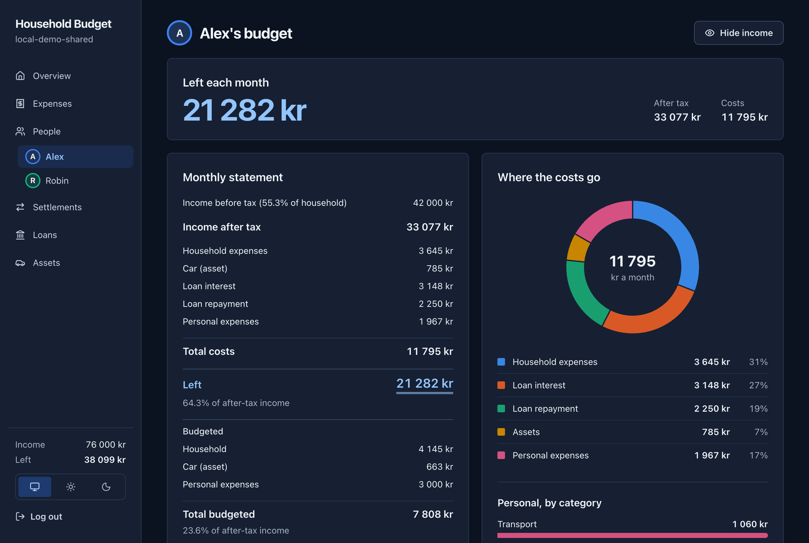
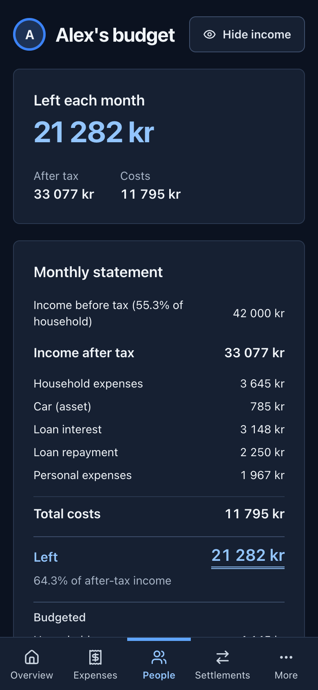
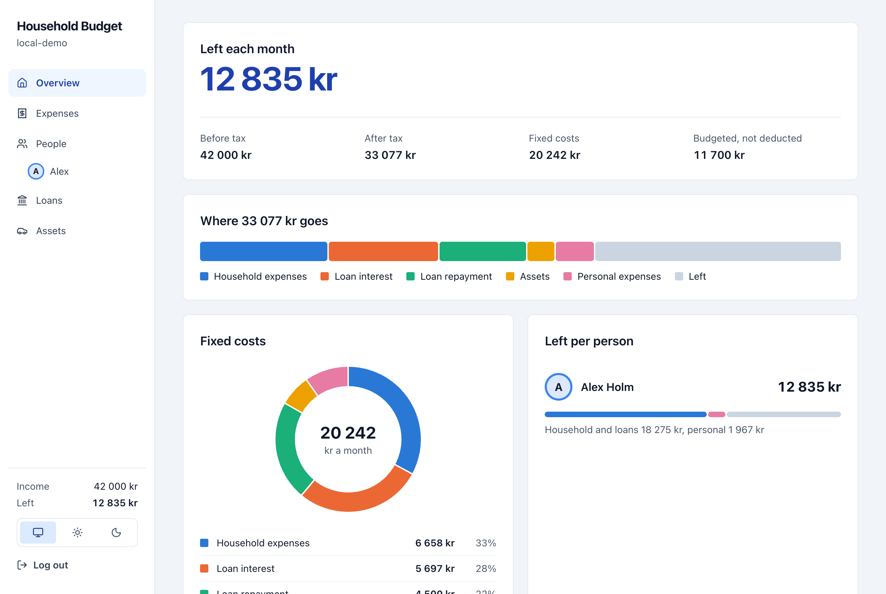
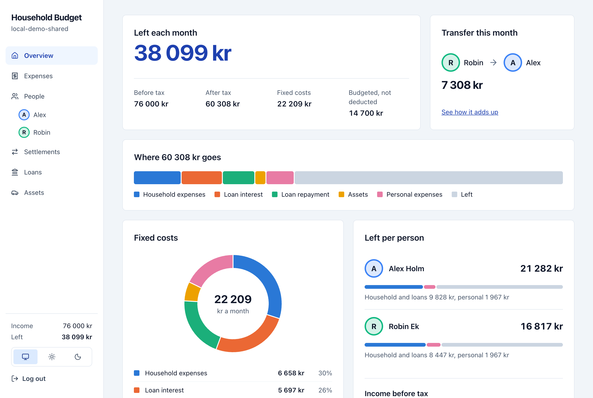

# 💸 Household Budget

A monthly budget for your home, whether you live alone or share it. See where
your money goes and what's left each month. If you share costs, it also works
out who owes whom.

**[Open the app](https://bombsimon.github.io/household-budget/)**

<p>
  
  
</p>

---

<table>
  <tr>
    <th width="50%">On your own</th>
    <th width="50%">Together</th>
  </tr>
  <tr>
    <td></td>
    <td></td>
  </tr>
</table>

## What it does

- Shows what's left after tax and fixed costs
- Tracks expenses, loans with interest and repayment, and the running costs of
  things like a car
- Calculates income after tax with Swedish municipality rates and tax tables
- Syncs between devices, on desktop and phone, in light or dark mode

When you're two or more, it also:

- Splits shared costs equally or by income
- Tells you who should transfer how much
- Gives each person their own budget, including their part of the shared costs

Living alone, you won't see splits or transfers. Add another person later and
they appear.

It's made for Sweden, so amounts are in kronor.

## Privacy

There are no accounts. A household has an ID and a password. If you share it,
everyone uses the same ones. The budget is encrypted in your browser before it's saved,
and the password is never sent to the server.

- **Choose a long password.** There's no way to reset it.
- **Choose an ID that's hard to guess.** Anyone who knows it can overwrite or
  delete the data, even though they can't read it.
- **Log out on shared computers.** The browser remembers the password until you
  do.

## Run it locally

You need Node.js 24. The Firestore emulator also needs Java.

```bash
npm install

# In one terminal
npm run emulator

# In another
npm run seed
npm run dev:local
```

This uses a local database that is emptied when the emulator stops. Seeding
creates the households `local-demo` and `local-demo-shared`, both with the
password `local-demo-password`. Skip it to start empty.

To use your own Firebase project, copy `.env.example` to `.env` and fill in the
values, then follow the [Firebase guide](FIREBASE_SETUP.md).

| Command               | What it does                  |
| --------------------- | ----------------------------- |
| `npm test`            | Run the tests                 |
| `npm run lint`        | Check the code                |
| `npm run prettify`    | Format everything             |
| `npm run build`       | Build for production          |
| `npm run screenshots` | Retake the README screenshots |

The screenshots use the same example data and need Google Chrome. Edit
`scripts/example-data.js` to change the data and `scripts/take-screenshots.js` to
change which pages are captured.

Pushing to `main` deploys to GitHub Pages. Firestore rules are deployed
separately with `npm run firebase:deploy:rules`.

Tax data has to be updated once a year, see
[municipality tax data](MUNICIPALITY_DATA.md).

## License

[MIT](LICENSE)
